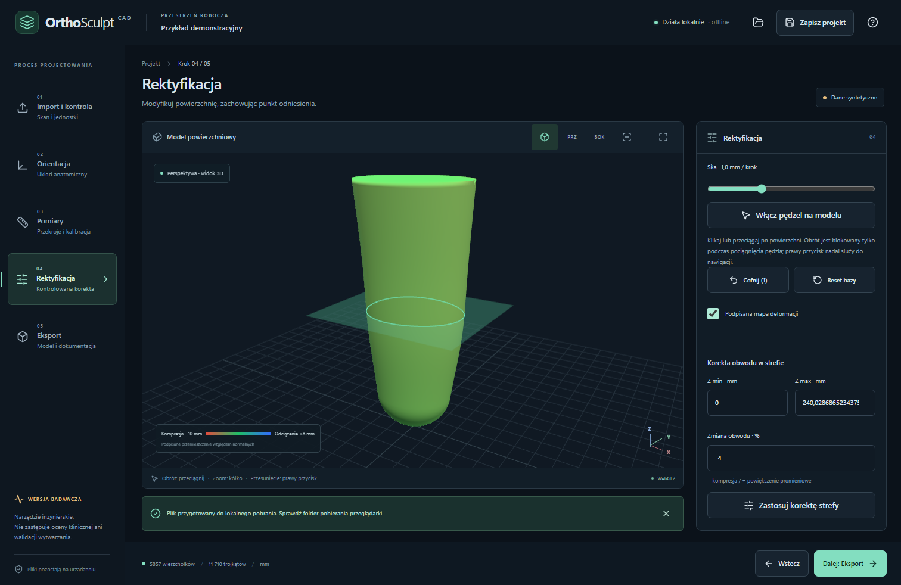

# OrthoSculpt CAD 0.2

[](https://github.com/mikelos151/OrthoSculptCAD/actions/workflows/ci.yml)
[](LICENSE)
[](https://www.typescriptlang.org/)
[](https://threejs.org/)
[](#local-first-architecture)

> **Open-source technical CAD suite for lower-limb prosthetics socket rectification, alignment, and biomechanical analysis.**

<p align="center">
  
</p>

<p align="center">
  <em>Stage 4 Socket Rectification: 3D interactive mesh brush sculpting, signed heatmaps, and biomechanical cross-sections.</em>
</p>

OrthoSculpt CAD is an independent, local-first 3D CAD application tailored for transtibial (TT) prosthetics socket design. It provides a structured five-stage workflow: 3D scan import/inspection (PLY/STL/OBJ), landmark-based anatomical alignment with principal component analysis (PCA), cross-sectional circumferential measurements, controlled socket rectification (relief/compression with Hermite falloff and signed displacement heatmaps), and verified STL/3MF production export.

Designed to empower independent prosthetists, academic researchers, and clinical technicians by eliminating costly proprietary cloud CAD vendor lock-in.

### Key Capabilities
- **Local-First & Zero Telemetry:** Runs entirely on `127.0.0.1`. No mandatory cloud accounts, external network requests, or tracking.
- **Five-Stage Rectification Pipeline:**
  1. *Import & Diagnostics:* Mesh edge checking, normal ordering, and flat boundary patching via Earcut.
  2. *Alignment (PCA):* Surface-moment based geometric axis calculation with right-handed anatomical coordinates.
  3. *Circumferential Measurement:* Section slice contours every 10/20 mm with real-time perimeter, AP/ML diameters, and volume approximation.
  4. *Socket Rectification:* Non-destructive raycasted relief/compression brush strokes with signed displacement delta maps.
  5. *Export:* Watertight binary STL, measurement tables (CSV), and encrypted revision archives.
- **Robust Concurrent Architecture:** Heavy geometric slice queries, topological inspections, and algebraic certifications execute in dedicated WebWorkers with transferable TypedArrays to ensure smooth UI responsiveness.
- **Provable Algebraic Verification:** Exact polynomial containment, dyadic splines, and B-spline seam continuity verified via custom arithmetic kernels without floating-point drift.

### Quick Start (Local Run)
1. **Requirements:** Node.js 22 or newer.
2. **Install & Run:**
   ```bash
   git clone https://github.com/mikelos151/OrthoSculptCAD.git
   cd OrthoSculptCAD
   npm install
   npm start
   ```
3. Open `http://127.0.0.1:4174` in your browser.

---

## Dokumentacja w języku polskim

# OrthoSculpt CAD 0.2 — pracownia TT do oceny technicznej

Lokalne narzędzie do kolorowych skanów i projektów lejów podudzia: orientacja, pomiary, kontrolowane korekty, porównanie z referencją i raport konkretnej rewizji. Polski pięcioetapowy kreator React/Three.js, rzeczywiste WebWorkers, testowalny rdzeń Rust oraz źródła powłoki Tauri 2. Zakres wytwarzania uzgodniony dla 0.2: STL/3MF do dalszego przygotowania produkcji; bez adaptera i CNC.

> **To nie jest zwalidowany produkt kliniczny ani gotowy proces wytwarzania protez.** Pliki mogą służyć do niezależnej analizy technicznej. Nie stosuj ich bez walidacji geometrii, materiału, procesu, wytrzymałości i dopasowania przez odpowiednich specjalistów.

## Uruchomienie dostarczonej wersji lokalnej

1. Rozpakuj cały ZIP do zwykłego katalogu.
2. Uruchom **Uruchom-OrthoSculpt.cmd**. Wymagany Node.js 22 lub nowszy (sprawdzono Node 24).
3. Otwórz `http://127.0.0.1:4174`, jeżeli przeglądarka nie otworzy się sama.
4. Zacznij od **Otwórz przykład** albo wybierz własny plik. Przykład jest jawnie syntetyczny.
5. Potwierdź jednostki źródłowe. Program nie rozpoznaje ich automatycznie.
6. Okno terminala pozostaje otwarte podczas pracy. `Ctrl+C` kończy lokalny serwer.

Gotowy `dist/` jest dołączony. Do uruchomienia go nie potrzeba `npm install`, konta, Rust, chmury ani internetu. Serwer korzysta wyłącznie z wbudowanych modułów Node i nasłuchuje tylko na `127.0.0.1`. Nie udostępnia API uploadu, zapisu ani dostępu do plików użytkownika. Import odbywa się po jawnym wyborze plików przez operatora. Jeżeli port jest zajęty, nie kończ cudzych procesów; możesz uruchomić `node scripts/server.mjs --port 4177` i otworzyć wskazany adres.

## Status aplikacji .exe

**Nie dostarczono gotowego .exe.** Ostatnia rzeczywista próba `cargo build --release --locked --offline --manifest-path src-tauri/Cargo.toml` (2026-10-26) nadal zatrzymała się na Windows AppControl **4551**, przy `generic-array` build-script. Wystąpiły też niezerowe kody procesów kompilatora. Nie zmieniano polityk ani nie przenoszono plików w celu obejścia blokady. Rust/MSVC/WebView2 są dostępne. Testy Rust nie zastępują kompilacji, startu Tauri, rzeczywistego IPC WebView i natywnego eksportu Blob — te pozostają niezweryfikowane.

Dalszy natywny build wymaga zatwierdzonego przez administratora środowiska kompilacji/podpisywania. Nie jest zalecane wyłączanie ochrony systemu tylko po to, żeby uruchomić build.

## Pięć etapów

### 1. Import i kontrola
- PLY ASCII/binary little/big endian z RGB, z siatką trójkątną.
- STL ASCII/binary; standardowy STL nie przenosi kolorów i jednostek.
- OBJ z lokalnym MTL i PNG/JPEG. Wybierz wszystkie pliki jednocześnie. Jeden wspólny obraz diffuse; nieobsługiwane kombinacje są odrzucane, a nie po cichu upraszczane.
- Diagnostyka krawędzi, nawinięcia i degeneracji. Naprawa usuwa degeneracje i domyka bezpieczne płaskie obrysy przez earcut. To nie pełny Liepa/Delaunay ani automatyczne usuwanie samoprzecięć.

Limit importu/projektu: 128 MiB, 16 plików, jeden model, 1 mln wierzchołków / 2 mln trójkątów. Tekstury tylko z podanych plików — bez URL, katalogów i żądań sieciowych. Nieobsługiwany PLY z UV/teksturą należy przekonwertować do obsługiwanego OBJ, zachowując informację o wyglądzie.

### 2. Orientacja
PCA wyznacza momenty powierzchni trójkątów, zamiast nadawać każdemu wierzchołkowi jednakową wagę. To propozycja osi geometrycznej, nie rozpoznanie anatomii. Wybierz lewą/prawą stronę i wskaż trzy punkty. Stała prawoskrętna rama: **X ku prawej pacjenta, Y do przodu, Z proksymalnie**; boczny marker lewej kończyny leży po −X. Nie wykonuje się lustrzanego odbicia. Niejednoznaczne/chiralnie niezgodne wskazania są odrzucane. Zapis obejmuje stronę, landmarki i rzeczywistą macierz rejestracji; zmiana strony ją unieważnia. Domyślna fleksja 0°, bez uniwersalnej recepty klinicznej.

### 3. Pomiary
Suwak przekroju i rzeczywisty kontur 2D. Tabela co 10/20 mm: obwód, AP, ML, pole i **przybliżona** objętość segmentu. Nieważne/otwarte/wielopętlowe przekroje nie otrzymują pozornego prawidłowego obwodu. Taśmę wpisuje się na ważnym poziomie. Kalibracja działa promieniowo w XY, zależnie od Z; Z pozostaje bez zmian. Po każdej zmianie siatki trzeba przeliczyć tabelę. Jeden obwód nie potwierdza osobno AP i ML, a wklęsły obrys nie jest pomiarem napiętej taśmy.

W przeglądarce kosztowne operacje TS oraz indeksowane przekroje działają w rzeczywistych module Workers. Wybrane kopie TypedArrays są transferowane; bufory renderera i historii pozostają podłączone. To nie end-to-end zero-copy. Rust zawiera osobny indeks BVH/przedziały i binarny protokół. Node bez przeglądarki korzysta z jawnego adaptera testowego TS; nie jest to dowód przeglądarkowej responsywności. Wyniki backendów i progi pracy wymagają niezależnych testów.

### 4. Rektyfikacja
Rzeczywisty raycast i relief/kompresja/wygładzanie z Hermite falloff. Gest zapisuje maksymalnie 128 wskazań; po zwolnieniu oblicza się całe pociągnięcie atomowo w anulowalnym Workerze. **Nie ma deformowanego podglądu w trakcie gestu ani deklaracji 60 FPS.** Udany gest tworzy jeden wpis i jedną pozycję cofania. Podpisana mapa również powstaje w Workerze, z osobnym sprawdzeniem bazy: zielony 0, niebieski relief+, czerwony kompresja−. UNKNOWN nie jest zerowym przemieszczeniem ani zgodą na podpisane narzędzia. Nie jest to mapa nacisku lub dopasowania. RGB źródłowe pozostaje oddzielne.

Orientacja/kalibracja tworzy nową referencję roboczą. Dziennik zachowuje decyzje i parametry; nie stanowi odtwarzalnego archiwum wszystkich siatek. Cofanie bieżącej sesji przechowuje geometrię, bazę, taśmy i potwierdzenie jednostek (do 20 kopii / 128 MiB; starsze kopie mogą wypaść). Ważne warianty zachowuj w osobnych plikach. Kalibracja zachowuje taśmy i wyświetla reszty po rzeczywistym ponownym cięciu, bez gwarancji dokładnego fitu. Zmiana obwodu nie jest takim samym procentem objętości. Strefy mają twarde granice. Po edycji kontroluj ponownie geometrię.

### 5. Eksport
- Binarny STL powierzchni po korekcie, CSV pomiarów.
- Projekty v2 z geometrią, bazą, RGB/UV/teksturą, taśmami, pseudonimowym kodem, stroną, kontekstem, rejestracją i dziennikiem; odczyt v1 z jawną migracją, bez wymyślonej wcześniejszej historii.
- Zapis domyślnie oferuje szyfrowanie hasłem; jawny JSON wymaga potwierdzenia ryzyka.
- Raport HTML konkretnej rewizji: rzeczywiste pomiary CAD/baza/taśmy, hash geometrii, zakres audytu, dziennik i ograniczenia. Druk/PDF sprawdzany w Chromium; inne silniki drukowania wymagają kontroli stopki i skali.
- Eksperymentalna powłoka: offset normalnych na zewnątrz, zachowane wnętrze, zszyty brzeg, obsługa bezpiecznej proksymalnej pokrywy również po lekkim pochyleniu PCA. Parametry grubości i kołowego wywinięcia obrzeża.
- Powłoka do STL lub rzeczywistego kontenera ZIP/OPC 3MF z jednostką mm.

**Normal-offset nie gwarantuje stałej grubości ani braku samoprzecięć.** Niezależna kontrola jest konieczna. Adapter producenta i CNC/G-code są jawnie niezrealizowane: brak danych producenta, tolerancji, badań połączenia oraz profilu maszyny/narzędzia/mocowania. Program nie generuje udawanych bezpiecznych komponentów lub ścieżek.

## Dane i prywatność

Bez kont, analityki, zewnętrznych fontów, usług AI, chmury i automatycznego zapisu projektu do localStorage/IndexedDB. Zaszyfrowany projekt używa standardowego WebCrypto PBKDF2-HMAC-SHA256 (600000 iteracji), losowych salt/IV i AES-256-GCM. Minimum hasła 12 znaków nie zastępuje silnej frazy. Hasło wpisuje operator wyłącznie w lokalnym oknie; bez niego nie ma odzyskania. JavaScript nie gwarantuje wyzerowania pamięci.

Jawny JSON, raport HTML/PDF, CSV, STL i 3MF **pozostają nieszyfrowane**. Kod przypadku nie oznacza pełnej anonimizacji. Notatki, kontekst i etykiety są swobodnym tekstem: przed udostępnieniem sprawdź zawartość. Filtr parametrów dziennika nie jest automatyczną anonimizacją. Operator odpowiada za folder, uprawnienia, retencję i kopie. Ostrzeżenie przy zastąpieniu/zamknięciu chroni niezapisaną pracę; wygenerowanie pobrania nie dowodzi trwałego zapisu na dysku. Lokalność i szyfrowanie nie stanowią deklaracji zgodności RODO/MDR.

## Rozwój i testy

```bash
npm ci
npm test
npm run build
npx playwright install chromium
npm run test:e2e
npm start
```

E2E używa zbudowanego `dist/` i naszego lokalnego serwera na porcie 4176, nie HMR. Najpierw wykonaj build. Zmiany kodu: `npm run dev` na porcie 4174. Rust (Cargo na PATH):

```bash
cargo test --release --manifest-path crates/ortho-geometry/Cargo.toml
cargo test --release --manifest-path src-tauri/state-tests/Cargo.toml
python src-tauri/tests/security_config.py
npm run desktop:build
```

Na tym Windows Cargo jest w `%USERPROFILE%\.cargo\bin\cargo.exe`; instalacja nie zmieniła globalnego PATH. Ostatnia komenda desktopowa jest obecnie zablokowana przez politykę aplikacji, jak opisano wyżej. Python nie jest potrzebny do działania gotowej wersji lokalnej.

## Dokumentacja

- `docs/RESEARCH.md` i `docs/RESEARCH-v02.md` — źródła, ograniczenia badań i kierunek pracowni TT; badania użyteczności z klientami nadal wymagane.
- `docs/REQUIREMENTS.md` — jawna realizacja i luki specyfikacji.
- `docs/verification/FINAL.md` — końcowy raport 0.2.0: 326 testów, 22 E2E, niezależne odbiory i jawne ograniczenia. Historyczny odbiór 0.1 zachowano w `FINAL-v01.md`.
- `docs/verification/geometry.md`, `io-manufacturing.md`, `ui.md`, `native.md` — szczegółowe dowody i ograniczenia modułów.
- `docs/screenshots/` — zrzuty rzeczywistej aplikacji, nie makiety.


## Granice wersji 0.2

- Obsługiwane atrybuty i nieobsługiwane szwy są jawne; bez cichego usuwania markerów RGB/UV.
- Audyt rozróżnia krawędzie, wierzchołki, komponenty, winding, przecięcia 3D i orientację. Budżet lub nierozstrzygnięta numeryka daje UNKNOWN, nie PASS. Domyślny audyt pełnej topologii/przecięć ma limit 200000 trójkątów; nie jest to limit samego importu. Większa siatka może pozostać niepotwierdzona i blokować zależne narzędzia. Nie ma ukrytego remeshingu.
- Samoprzecinający lub nieprzebadany offset nie jest pozytywnie zatwierdzoną powłoką. Parametr offsetu nie gwarantuje minimalnej grubości, wytrzymałości, materiału ani klinicznego fitu.
- Zaszyfrowany projekt ma niższy limit treści niż 128 MiB ze względu na base64/tag/metadane (około96 MiB); dokładne granice są w `src/io/cryptoLimits.ts`.
- Reprezentatywne skany i ocena protetyka pozostają bramką odbioru poza testami syntetycznymi. Nie wykonano badań rynku, gotowości do zapłaty ani walidacji klinicznej.

### Dodatkowa weryfikacja deweloperska

`ORTHO_REAL_WORKER=1 npx vitest run tests/v02-compute-browser.test.ts` uruchamia prawdziwe testy Chromium, pomijane w zwykłym Node. `node scripts/verify-review-report.mjs` wymaga przeglądarki Playwright i interpretera z PyMuPDF wskazanego przez `REPORT_PDF_PYTHON` (domyślnie `python`). Interpreter i moduł są narzędziami kontroli raportu, nie zależnością zwykłego działania aplikacji. Nie ma zaszytej ścieżki do prywatnego katalogu dewelopera.

Pełny odbiór (z Playwright Chromium, Pythonem/PyMuPDF i ustawionym `REPORT_PDF_PYTHON`):

```bash
ORTHO_REAL_WORKER=1 ORTHO_REAL_REPORT_PDF=1 npx vitest run --maxWorkers=1
npm run build
E2E_REPORT_NAME=local-check node scripts/v02-ui-acceptance.mjs
```

Uruchamiaj te próby kolejno, nie równolegle. Zwykły `npm test` pomija testy przeglądarkowe/PDF wymagające tych flag; końcowy odbiór wykonał je wszystkie. Raport nieudanego równoległego przebiegu z timeoutami zachowano obok udanego pełnego powtórzenia.

Nie deklaruje się FPS, opóźnienia <0,5 ms, wytrzymałości, gotowości produkcyjnej ani zgodności regulacyjnej bez właściwych badań.
